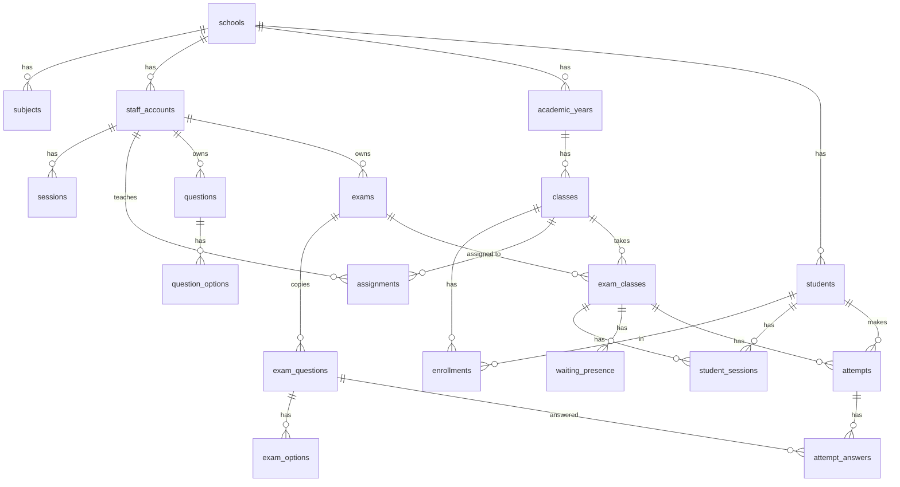

# ERD (as-built): Quiq

> Overview + pointer. **Không chép cột/kiểu tay**: chi tiết lấy từ schema + migration.
> Overview này khác schema/migration → **schema/migration thắng**.
> Cập nhật lần cuối: 2026-11-26, sau Layer 2 (schema từ L1-01, chưa có migration mới).

## Source of truth

1. **Schema Drizzle**: `packages/db/src/schema/` (`org.ts`, `people.ts`, `bank.ts`, `exam.ts`, `attempt.ts`), export qua `@quiq/db`.
2. **Migration versioned**: `packages/db/migrations/` (`0000_init.sql`, `0001_lock_down_public_roles.sql`), tool `drizzle-kit` (xem `.context/project-config.md`).
3. **Seed demo**: `packages/db/src/seed/demo.ts` (trường "Trường THPT Demo", `gv.toan`, lớp `10A1`, `HS001..HS005`, 30 câu, bài `DEMO01`).

## Database

PostgreSQL trên Supabase (staging); test dùng PGlite đã migrate. ORM Drizzle, driver postgres-js.
RLS **bật trên mọi bảng, không có policy**; `0001` thu hồi quyền bảng của `anon`/`authenticated`. Trình duyệt không gọi Supabase trực tiếp, mọi truy cập qua Koa (C-11).

## Quy ước chung

- Khóa chính `uuid` (`defaultRandom`), trừ `waiting_presence` (khóa ghép `exam_class_id + student_id`).
- **Cô lập trường bằng FK ghép:** hầu hết bảng có `school_id`, mỗi bảng cha có `unique(school_id, id)` và bảng con tham chiếu bằng FK ghép `(school_id, <parent>_id)`. DB không cho tạo quan hệ chéo trường.
- Trạng thái lưu bằng `text` + `check` (không dùng pgEnum); hằng số export từ schema: `SCHOOL_STATUSES = active|locked`, `STAFF_ROLES = super_admin|school_admin|teacher`, `DIFFICULTIES = easy|medium|hard`, `EXAM_CLASS_STATUSES = draft|dispatched|closed`, `ATTEMPT_STATUSES = waiting|in_progress|submitted|interrupted`.

## Entity overview

| Nhóm | Bảng | Mục đích | Quan hệ chính |
|---|---|---|---|
| Tổ chức (`org.ts`) | `schools` | Trường + quy chế (`max_attempts`, `warn_limit`, `interrupt_secs`), `status` | gốc của mọi `school_id` |
| | `subjects` | Môn học của trường | thuộc `schools`; unique tên theo trường |
| | `staff_accounts` | Tài khoản cán bộ (vai trò, hash mật khẩu scrypt, môn của giáo viên) | thuộc `schools` (null với `super_admin`), FK ghép tới `subjects`; username unique không phân biệt hoa thường |
| | `sessions` | Phiên cán bộ (`token_hash` = HMAC, `expires_at` trượt, `revoked_at`) | thuộc `staff_accounts` (xóa theo) |
| Người (`people.ts`) | `academic_years` | Năm học | thuộc `schools`; tối đa một năm `is_current` mỗi trường |
| | `classes` | Lớp theo năm học | FK ghép tới `academic_years`; unique tên theo năm |
| | `students` | Học sinh (`code` unique theo trường, cờ vô hiệu/ẩn danh) | thuộc `schools` |
| | `enrollments` | Học sinh thuộc lớp | FK ghép tới `students`, `classes` |
| | `assignments` | Giáo viên phụ trách lớp | FK ghép tới `staff_accounts`, `classes` |
| Ngân hàng (`bank.ts`) | `questions` | Câu hỏi của giáo viên (độ khó, môn) | FK ghép tới `staff_accounts`, `subjects` |
| | `question_options` | Đáp án của câu (`is_correct`, `position`) | FK ghép tới `questions` |
| Đề thi (`exam.ts`) | `exams` | Bài thi (`code` unique toàn hệ thống, `duration_minutes`) | FK ghép tới `staff_accounts`, `subjects` |
| | `exam_questions` | **Bản sao** câu hỏi trong đề (không trỏ ngược ngân hàng, sửa ngân hàng không ảnh hưởng đề) | FK ghép tới `exams` |
| | `exam_options` | Bản sao đáp án trong đề (`is_correct` chỉ dùng chấm) | FK ghép tới `exam_questions` |
| | `exam_classes` | Bài thi giao cho lớp: `status` draft/dispatched/closed + snapshot quy chế lúc phát đề | FK ghép tới `exams`, `classes`; unique `(exam_id, class_id)` |
| Làm bài (`attempt.ts`) | `student_sessions` | Phiên học sinh (`token_hash` SHA-256, `revoked_at`) | FK ghép tới `students`, `exam_classes`; **tối đa một phiên chưa thu hồi mỗi học sinh** (unique partial) |
| | `waiting_presence` | Học sinh có mặt ở phòng chờ (`last_seen`) | PK `(exam_class_id, student_id)` |
| | `attempts` | Lần làm bài (`status`, `started_at`, `ends_at`, `score` 0..10, thứ tự câu/đáp án đã trộn) | FK ghép tới `students`, `exam_classes`; **tối đa một `in_progress` mỗi học sinh** (unique partial) |
| | `attempt_answers` | Lựa chọn của học sinh cho từng câu | FK ghép tới `attempts`, `exam_questions`; unique `(attempt_id, exam_question_id)` |

## Ràng buộc nghiệp vụ nằm ở DB

- `attempts`: `in_progress` phải có `started_at`, `ends_at`; `submitted` phải có `submitted_at`; `attempt_no >= 1`; `score` trong 0..10.
- `exam_classes`: ràng buộc dispatch (`exam_classes_dispatch_check`) giữa `status` và các mốc phát đề.
- `students`: đã ẩn danh thì mã phải bị vô hiệu.
- **Chưa ràng buộc ở DB, API phải tự kiểm:** `attempt_answers` cùng đề với attempt (kiểm ở `apps/api/src/modules/attempts/selection.ts`).

## Diagram

